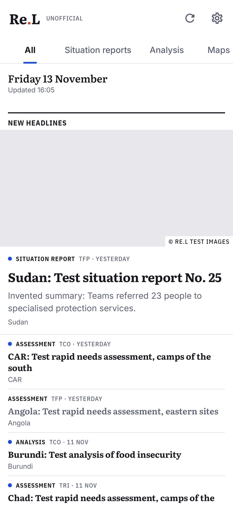
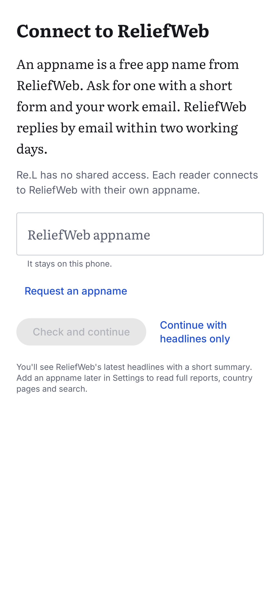

# Re.L, an unofficial ReliefWeb reader for Android

**Not affiliated with ReliefWeb or OCHA.**

**Wake up and read the humanitarian news from [ReliefWeb](https://reliefweb.int).**

ReliefWeb closed its mobile apps in 2018, so I built a reader app.

Re.L is a preview, built in the open in my free time, to stay closer to the humanitarian news. A lot is still missing, and feedback is welcome: [open an issue](https://github.com/13w13/relief-reader/issues). This is a personal project, not connected to my employer.

 

*Screenshots use made-up sample data.*

## What it does

- **Reads like a news app.** A Today page that ends, then the countries, crises and organizations you follow.
- **PDFs as text.** Most reports on ReliefWeb are PDFs. Once one is on your phone, Re.L shows it as readable text, with the original one tap away.
- **Works offline.** Reports from what you follow are stored on your phone.
- **Keeps what you read.** Save, highlight, copy with a citation, and export your highlights.
- **No AI in the app.** No generated summaries, no scores. You read what the organizations wrote.
- **No ads, no account, no tracking.** Re.L collects no data.

## Get it

1. **Download the APK** from the [latest release](https://github.com/13w13/relief-reader/releases/latest) and open it on your phone (Android 8.0 or later).
2. **Open Re.L** and tap **Continue with headlines only**. You can read ReliefWeb's latest headlines straight away.
3. **[Ask ReliefWeb for a free appname](https://docs.google.com/forms/d/e/1FAIpQLScR5EE_SBhweLLg_2xMCnXNbT6md4zxqIB00OL0yZWyrqX_Nw/viewform)** with your work email. ReliefWeb replies within two business days. Enter the appname in the app to unlock full reports, country pages and search.

The [release notes](https://github.com/13w13/relief-reader/releases/latest) describe everything the app does.

## Install and update

Re.L is not on Google Play. On your phone, download the `.apk` file under **Assets** in the [latest release](https://github.com/13w13/relief-reader/releases/latest) and open it. Your browser, Android or Google Play Protect may warn about an app they don't know. Download it only from this page.

To update, install the new APK over the old one. Your countries, Library and settings stay. To hear about new versions, use **Watch > Custom > Releases** on this page.

<details>
<summary>Check the signature, and a note for Brazil, Indonesia, Singapore and Thailand</summary>

Every release is signed with the same key. To check an APK, for example with AppVerifier, compare the SHA-256 fingerprint of its signing certificate with this one:

```
37:7E:8D:D3:41:4E:89:4C:7F:65:D0:C0:F7:99:D3:D2:17:62:01:46:98:40:88:02:9F:6C:4C:30:F7:11:7E:26
```

In Brazil, Indonesia, Singapore and Thailand, Android has blocked apps from unverified developers since 30 September 2026, on certified devices. Re.L is not registered with Google's developer verification, so installing it there goes through Android's advanced flow: a one-time setup, a restart and a 24-hour wait. Google plans to extend the rule to other countries from 2027. Source: [Android developer verification](https://developer.android.com/developer-verification).

</details>

## Your ReliefWeb appname

ReliefWeb asks every app that reads its API to use an approved name, called an appname. Re.L has none built in: each reader uses their own.

- **Ask for it** with ReliefWeb's [appname request form](https://docs.google.com/forms/d/e/1FAIpQLScR5EE_SBhweLLg_2xMCnXNbT6md4zxqIB00OL0yZWyrqX_Nw/viewform). If the link has moved, the [API documentation](https://apidoc.reliefweb.int/#appname) has the current one.
- **Use your work email.** ReliefWeb does not accept Gmail, Yahoo or Hotmail addresses.
- **Purpose:** one sentence is enough, for example "Reading ReliefWeb on my phone with Re.L, an open-source reader: https://github.com/13w13/relief-reader".
- **Preferred appname:** `<organization>-reader-<random>`. ReliefWeb may adjust it.
- **Enter it** when you first open Re.L, or later in Settings > ReliefWeb access. It works at once and stays on your phone.

Keep your appname to yourself. Don't publish it, don't paste it in an issue, and don't build it into a fork.

## Privacy

Re.L has no account, no ads, no analytics and no crash reporting. It talks to `api.reliefweb.int` and `reliefweb.int`. When a report includes an image hosted on another site, the app loads that image from there. What you follow, what you read, your highlights and your appname stay on your phone. It asks for internet access and, if you want the daily summary or alerts, for notifications.

## Whose content this is

Reports, PDFs and images come from ReliefWeb and its API, run by the UN Office for the Coordination of Humanitarian Affairs (OCHA). They belong to ReliefWeb and to the organizations that publish them, and [ReliefWeb's terms](https://reliefweb.int/terms-conditions) apply. Every report shows its source, its dates and a link to ReliefWeb. Re.L uses no ReliefWeb or OCHA logo.

## Feedback

Open an [issue](https://github.com/13w13/relief-reader/issues) for a bug or an idea. For a bug, give your phone model, your Android version and the app version (Settings > About Re.L).

For a security problem, [report it privately](https://github.com/13w13/relief-reader/security/advisories/new) instead. See [SECURITY.md](SECURITY.md).

## Build it yourself

Re.L is written in Kotlin with Jetpack Compose. You need JDK 17 and the Android SDK.

```bash
./gradlew :app:assembleDebug
```

The build needs no secret and no appname, and the tests run on made-up sample data. This is a spare-time project: pull requests are welcome, and answers may take a while.

## Licence

Re.L is free software under the GNU General Public License, version 3 or later (`GPL-3.0-or-later`). See [LICENSE](LICENSE) and [THIRD_PARTY_NOTICES](THIRD_PARTY_NOTICES). The licence covers the code only, not the reports.

---

<sub>Built with the help of AI coding tools. The app itself contains none.</sub>
